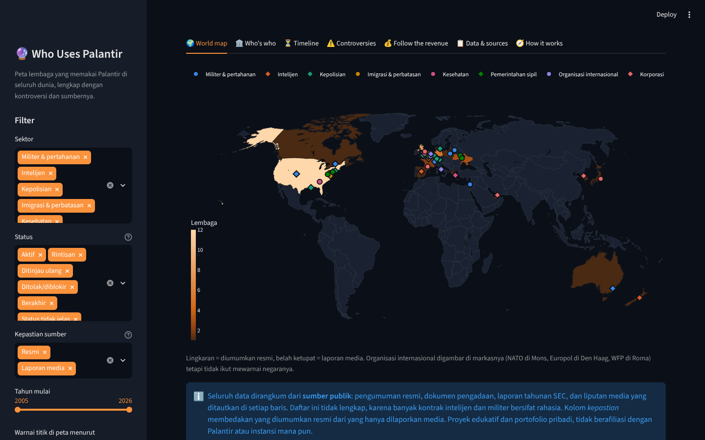
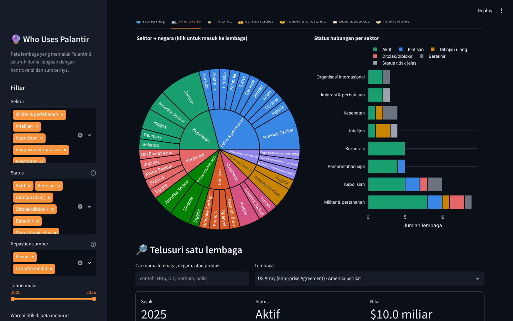
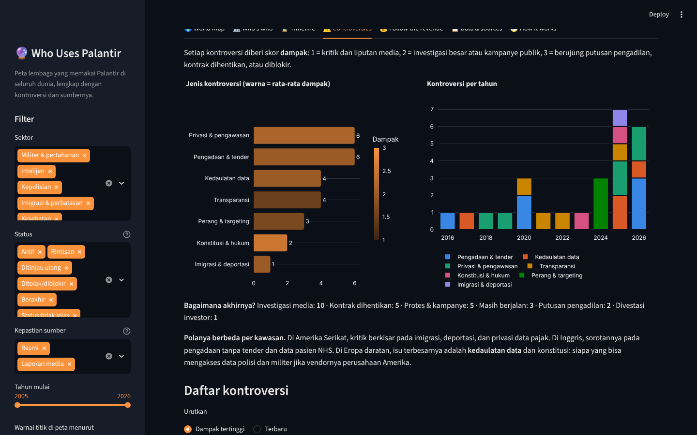
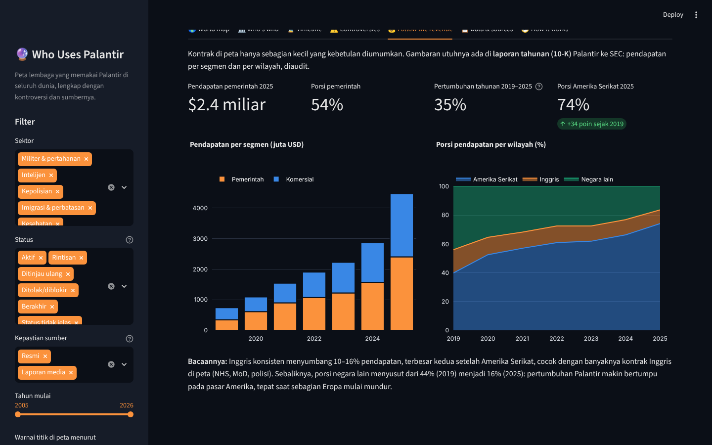
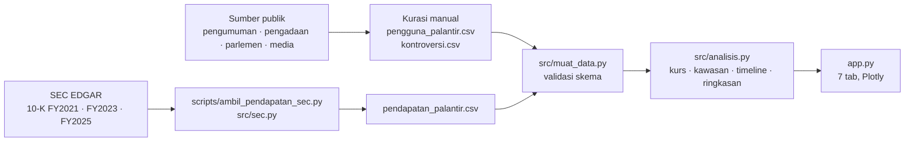

# 🔮 Who Uses Palantir

[](https://github.com/Avalon2222/who-uses-palantir/actions/workflows/tests.yml) [](https://www.python.org/) [](LICENSE) [](https://who-uses-palantir.streamlit.app)

> Peta dunia **48 lembaga dan kontrak Palantir** di 19 negara dan 3 organisasi internasional: militer, intelijen,
> polisi, imigrasi, rumah sakit, sampai korporasi. Setiap baris punya sumber, status, nilai kontrak bila diumumkan,
> dan kontroversi yang mengikutinya, ditambah data pendapatan Palantir 2019–2025 langsung dari laporan 10-K SEC.
> Python, pandas, Plotly, Streamlit.

## 🇬🇧 In English

**The seeing stone has customers.** A sourced world map of who buys Palantir: armies, spy agencies, police forces, immigration enforcement, health systems and a few big corporations. Every entry links to its source, says whether it was officially announced or only reported by the press, and connects to the controversies it triggered, from a German constitutional court ruling to London's mayor blocking a police contract.

- **Map** 48 deployments across 19 countries plus NATO, Europol and the UN World Food Programme.
- **Track** how adoption spread from 2005 to 2026, and the 2026 European pullback over data sovereignty.
- **Rank** 26 controversies by type and consequence (criticism, investigation, court ruling, cancelled contract).
- **Follow the money** with segment and regional revenue parsed straight from Palantir's SEC 10-K filings.

**Built with:** Python, pandas, Plotly, Streamlit, lxml  
**Data:** hand-curated public sources (official announcements, procurement records, investigative journalism) + SEC EDGAR  
**Engineering:** validated dataset schema, an EDGAR table parser, and a pytest suite with CI on GitHub Actions

*The rest of this README is in Indonesian.*

**🚀 Coba langsung di browser:** [who-uses-palantir.streamlit.app](https://who-uses-palantir.streamlit.app)



> ℹ️ **Disclaimer.** Seluruh data dirangkum dari **sumber publik** yang ditautkan di setiap baris. Daftar ini tidak
> lengkap, karena banyak kontrak intelijen dan militer bersifat rahasia. Kolom `kepastian` membedakan yang diumumkan
> resmi dari yang hanya dilaporkan media. Skor dampak menggambarkan konsekuensi sebuah kontroversi, bukan menilai
> siapa yang benar. Proyek edukatif dan portofolio pribadi, tidak berafiliasi dengan Palantir atau instansi mana pun.

## Latar belakang

Palantir jarang terlihat, tetapi ada di mana-mana: di balik dashboard pandemi NHS, sistem deportasi ICE, targeting
di Ukraina, sampai analisis data polisi Jerman. Perusahaan ini tidak mengumpulkan data sendiri. Yang dijualnya adalah
kemampuan **menyatukan** data yang sebelumnya terpisah, dan justru di situlah perdebatannya: data yang aman saat
terpisah bisa menjadi alat pengawasan saat disatukan.

Pertanyaannya sederhana: **siapa saja yang sebenarnya memakai Palantir, sejak kapan, dan apa yang terjadi
sesudahnya?** Jawabannya tersebar di ratusan siaran pers, dokumen pengadaan, jawaban parlemen, dan investigasi
jurnalis dalam enam bahasa. Proyek ini mengumpulkannya ke dalam satu dataset yang bisa diperiksa ulang, lalu
memetakannya.

## Fitur

| Tab | Isi |
|---|---|
| 🌍 World map | Choropleth jumlah lembaga per negara + titik setiap lembaga di kotanya (warna menurut sektor atau status, bentuk menurut kepastian sumber), tabel negara, dan catatan khusus Indonesia & ASEAN |
| 🏛️ Who's who | Sunburst sektor → negara → lembaga, status hubungan per sektor, dan pencarian satu lembaga lengkap dengan nilai kontrak, sumber, dan kontroversinya |
| ⏳ Timeline | Kapan setiap lembaga mulai, jumlah lembaga aktif per tahun, dan **peta animasi** penyebaran 2005–2026 |
| ⚠️ Controversies | 26 kontroversi menurut jenis, tahun, dan hasil akhirnya, dengan skor dampak 1–3 dan tautan sumber |
| 💰 Follow the revenue | Pendapatan pemerintah vs komersial dan porsi Amerika Serikat / Inggris / negara lain 2019–2025 dari 10-K SEC |
| 📋 Data & sources | Tiga tabel yang bisa diunduh, metodologi, kurs, dan keterbatasan |
| 🧭 How it works | Alur data dan penjelasan produk Palantir (Gotham, Foundry, AIP, Maven, MetaConstellation) |
| 🎓 Learning mode | Toggle di sidebar: penjelasan kode, rumus, dan jebakan yang ditemukan saat membangun aplikasi |





## Cara menjalankan

```bash
git clone https://github.com/Avalon2222/who-uses-palantir.git
cd who-uses-palantir
python -m venv .venv && source .venv/bin/activate   # Windows: .venv\Scripts\activate
pip install -r requirements.txt
streamlit run app.py
```

Buka `http://localhost:8501`. Jalankan pengujian dengan `python -m pytest tests/ -v` (28 tes, tanpa internet).

Memperbarui data pendapatan setelah Palantir menerbitkan 10-K baru (biasanya Februari):

```bash
python scripts/ambil_pendapatan_sec.py
```

Tambahkan dulu nomor akses 10-K terbaru ke daftar `LAPORAN` di skrip tersebut, dan ganti alamat email contoh di
`User-Agent` dengan email kamu (SEC menolak permintaan tanpa kontak).

## Cara kerja (ringkas)



| Modul | Yang dilakukan |
|---|---|
| `data/*.csv` | Dataset kurasi: satu baris per lembaga (20 kolom: sektor, produk, tahun, status, nilai, koordinat, kepastian, sumber, id kontroversi) dan satu baris per kontroversi |
| `src/muat_data.py` | Membaca CSV dengan tipe yang benar (`Int64` untuk tahun yang boleh kosong) dan `validasi()` yang memeriksa sektor, status, URL https, ISO-3, koordinat, mata uang, urutan tahun, dan tautan ke kontroversi |
| `src/sec.py` | Parser tabel 10-K: merapikan sel yang terpecah dan terduplikasi, membedakan tabel pendapatan dari tabel laba kontribusi, melewati kolom persen |
| `src/analisis.py` | Konversi kurs, kawasan, filter, ringkasan per negara, "aktif pada tahun X", timeline, peta per tahun, ringkasan kontroversi, pangsa pendapatan, CAGR |
| `app.py` | Sidebar (sektor, status, kepastian, tahun, learning mode) → tujuh tab |

Definisi yang dipakai:

- **Status**: *Aktif*, *Rintisan* (letter of intent, pilot, atau belum beroperasi), *Ditinjau ulang* (berjalan tetapi
  dievaluasi atau dijadwalkan diganti), *Ditolak/diblokir*, *Berakhir*, *Status tidak jelas*.
- **Kepastian**: *Resmi* = diumumkan pemerintah/Palantir atau tercatat di dokumen pengadaan; *Laporan media* =
  berasal dari liputan jurnalis.
- **Dampak kontroversi**: 1 = kritik dan liputan, 2 = investigasi besar atau kampanye publik, 3 = putusan pengadilan,
  kontrak dihentikan, atau diblokir.
- **Nilai kontrak** sering berupa plafon, bukan belanja nyata; dikonversi ke USD dengan kurs perkiraan tetap.

## Data

| Data | Sumber | Keterangan |
|---|---|---|
| Lembaga pengguna | Kurasi dari 55 tautan sumber publik (49 media dan lembaga) | `data/pengguna_palantir.csv`: 48 baris, 17 resmi + 31 laporan media, kurasi November 2026 |
| Kontroversi | Kurasi dari liputan, putusan, dan dokumen parlemen | `data/kontroversi.csv`: 26 baris, 2016–2026 |
| Pendapatan Palantir | [SEC EDGAR](https://www.sec.gov/cgi-bin/browse-edgar?action=getcompany&CIK=0001321655&type=10-K), 10-K FY2021/FY2023/FY2025 | `data/pendapatan_palantir.csv`: segmen & wilayah 2019–2025, juta USD |

Rincian, aturan kurasi, dan keterbatasan ada di [`data/SUMBER_DATA.md`](data/SUMBER_DATA.md).

## Yang ditemukan (snapshot November 2026)

- **Semua lembaga yang sedang mundur ada di Eropa.** Tujuh lembaga berstatus *ditinjau ulang* atau *ditolak*:
  NHS England, Met Police London, Bundeswehr, DGSI Prancis, Kementerian Pertahanan Belanda, militer Swiss, dan
  intelijen militer Spanyol. Alasannya hampir selalu sama: **kedaulatan data**, yaitu siapa yang bisa mengakses data
  polisi dan militer bila vendornya perusahaan Amerika.
- **Sementara itu Amerika makin dalam.** Plafon kontrak baru 2024–2026 di AS saja (Army $10 miliar, Maven $1,3 miliar,
  DHS $1 miliar, Navy $448 juta, USDA $300 juta) melampaui seluruh kontrak publik negara lain digabung.
- **Laporan keuangan mengonfirmasi polanya.** Porsi Amerika Serikat di pendapatan Palantir naik dari 40% (2019)
  menjadi **74% (2025)**; porsi negara selain AS dan Inggris turun dari 44% ke 16%. Inggris stabil di 10–16%,
  pasar terbesar kedua, sesuai banyaknya kontrak Inggris di peta (NHS, MoD, polisi, regulator keuangan).
- **Pemerintah tetap separuh bisnisnya.** Segmen pemerintah 54% dari pendapatan 2025 ($2,4 miliar); total pendapatan
  tumbuh rata-rata 35% per tahun sejak 2019.
- **Kontroversinya berbeda per kawasan.** AS: imigrasi, deportasi, dan data pajak. Inggris: pengadaan tanpa tender
  dan data pasien. Eropa daratan: konstitusi dan kedaulatan. Dua kontroversi berujung putusan pengadilan
  (gugatan DCGS-A 2016 yang dimenangkan Palantir, dan Mahkamah Konstitusi Jerman 2023).
- **Indonesia dan ASEAN: tidak ditemukan kontrak publik.** Pelanggan Asia yang terdokumentasi adalah korporasi Jepang
  dan Korea Selatan, serta militer dan intelijen Australia dan Selandia Baru.

## Struktur repo

```
who-uses-palantir/
├── app.py                        # UI Streamlit (sidebar, 7 tab, peta, grafik)
├── src/
│   ├── muat_data.py              # baca CSV + validasi skema
│   ├── analisis.py               # kurs, kawasan, timeline, ringkasan, pangsa pendapatan
│   └── sec.py                    # parser tabel 10-K SEC EDGAR
├── scripts/
│   ├── ambil_pendapatan_sec.py   # bangun ulang data/pendapatan_palantir.csv
│   └── tangkap_layar.py          # screenshot untuk README (Playwright)
├── data/                         # pengguna_palantir.csv, kontroversi.csv, pendapatan_palantir.csv, SUMBER_DATA.md
├── docs/                         # BELAJAR.md, LATIHAN.md, screenshots/
├── tests/                        # pytest: data, analisis, parser SEC
└── requirements.txt
```

## Belajar dari proyek ini

- [`docs/BELAJAR.md`](docs/BELAJAR.md): cara merancang dataset kurasi yang bisa diperiksa ulang, validasi skema,
  membaca tabel 10-K, peta dua lapis Plotly, dan logika "aktif pada tahun X".
- [`docs/LATIHAN.md`](docs/LATIHAN.md): delapan latihan bertingkat, dari menambah lembaga baru sampai mengambil
  kontrak otomatis dari USAspending dan membandingkannya dengan data kurasi.

## Rencana berikutnya

- Menarik kontrak federal AS otomatis dari USAspending.gov dan kontrak Inggris dari Contracts Finder, lalu mencocokkan
  dengan dataset kurasi.
- Riwayat perubahan per lembaga (kapan diperpanjang, kapan ditinjau), bukan hanya status terakhir.
- Versi bahasa Inggris untuk ringkasan setiap lembaga.

## Lisensi

Kode: MIT. Ringkasan dataset ditulis sendiri; fakta dan angka mengikuti sumber yang ditautkan di setiap baris.
